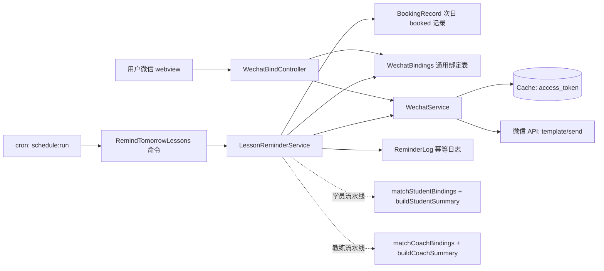

## 产品概述
在约刻（yueke）约课系统中接入微信服务号，实现「每天晚上自动给第二天有课的**学员和教练**推送上课提醒卡片」。两类用户均在微信里打开绑定页完成身份绑定（手机号优先匹配，匹配不到时按机构+姓名选择），之后系统每天定点扫描次日约课记录，按人汇总成一条模板消息卡片推送。

身份 careers：
- **学员**：知道「我明天几点上课、在哪片场、哪个教练带」（按学员汇总一条）。
- **教练**：知道「我明天几点开始一天、共几节课、分别是哪几个学员」（按教练汇总一条，包含全天课程清单）。

## 核心功能

1. **微信绑定（免登录移动端页面，学员/教练共用同一页）**
   - 用户在微信内置浏览器打开链接 → 网页授权（`snsapi_base`）静默获取 openid → 进入绑定页。
   - 页面顶部两 Tab：**我是学员 / 我是教练**（默认学员），同一 openid 可同时持有两类身份，互不影响。
   - 主流程：输入手机号 → 校验是否命中对应表（`students.phone` / `coaches.phone`）→ 命中即绑定；命中多条时先选机构再选姓名。
   - 补充流程（用户明确要求）：手机号匹配不上（如后台该学员未登记手机号）时，提供「机构下拉 → 姓名下拉」两级选择手动匹配。
   - 已绑定时显示绑定状态卡 + **明日课程列表**（学员看自己的课，教练看自己全天课表）。
   - 支持一个微信绑定多个学员（同一家长管多个孩子）/ 多个教练身份，可解绑、重绑。

2. **每日学员上课提醒**
   - 每天定点（默认 20:00，`Asia/Shanghai`）执行 `php artisan bookings:remind`，扫描次日 00:00–24:00 内 `status=booked` 的约课记录。
   - 默认**按学员汇总成一条**卡片：标题「明日上课提醒」，内含多条课程明细（时间、场地、教练）；`--per-lesson` 可切为每节课一条。
   - 点击卡片跳回绑定页查看明日课表。

3. **每日教练上课提醒**
   - 同一命令、同一时间点执行，独立总开关（`WECHAT_COACH_REMIND_ENABLED`）。
   - **按教练汇总成一条**卡片：首节课时间 / 末节课时间、当天总课时数、场地、学员名单（超过 N 人显示「张三 等 X 人」）。
   - 使用**独立的微信模板**（`WECHAT_COACH_TEMPLATE_ID`），关键词为「上课时段 / 课时数 / 场地 / 学员」；若未配置则回退到学员模板并降级渲染文案。
   - 教练名匹配要点：`booking_records.coach_name` 写入前已经 `CoachService::resolveCoachName()` 别名归一，因此与 `coaches.name` 可**精确比对**（不像学员名那样需要包含匹配兜底）。

4. **幂等与容错**
   - `reminder_logs` 记录每次发送，唯一键保证「同一天同一人同一范围」不重复发送；`--force` 可强制重发。
   - 发送失败分类处理：`40003/43004`（openid 无效/未关注）→ 标记该绑定失效并跳过；`42001`（token 过期）→ 刷新 token 重试一次；其他错误记录日志，不影响同批其他人。
   - 课程在推送后被取消不撤回（本次不做撤回通知）。

5. **多机构隔离**
   - 所有绑定记录与提醒日志均带 `organization_code`；定时任务按机构分组处理，机构之间互不可见。同一手机号在不同机构重复时，必须让用户选择机构后才能绑定，禁止跨机构误绑。

## 范围边界（本次不做）
微信支付、自定义菜单、关键词自动回复、客服消息、学员账号密码登录体系、短信验证码、提醒撤回通知、场馆/管理员端提醒。


## 技术栈选型

沿用现有项目栈，不引入新框架/新语言：

| 层 | 选择 | 理由 |
|---|---|---|
| 后端 | Laravel 12 + PHP 8.2（现有） | 与项目一致 |
| HTTP 客户端 | `Illuminate\Support\Facades\Http`（Guzzle） | Laravel 自带，零新增依赖 |
| 微信 SDK | **不引入** EasyWeChat / overtrue/laravel-wechat | 只用 3 个接口（access_token、网页授权、发送模板消息）；项目当前零第三方微信依赖，`DoubaoService` 已是「Http + 配置驱动」无 SDK 风格；避免 Laravel 12 兼容性与依赖膨胀风险 |
| 定时 | Laravel Scheduler（`->withSchedule`）+ cron | 用户已确认；`withoutOverlapping()` 依赖已配置的 database cache |
| DB | MySQL / 测试用 SQLite in-memory（现有约定） | 一致 |
| 前端 | Blade + 原生内联脚本/静态 CSS（`public/css/*.css`） | 绑定页是微信 webview 的移动端单页，与 `login.blade.php` 同风格，不进 Vite 构建，减少构建链路改动 |

## 实现思路

整体分三层，**依赖方向单向**：`Console Command → LessonReminderService → WechatService`，绑定页走 `WechatBindController → WechatService`。

1. **`WechatService`（基础设施层）**：封装微信官方 API 的薄客户端。核心是 `access_token` 中控缓存——微信要求全局唯一 token 且日调用有限，必须服务端缓存而非每次请求都刷新。用 `Cache` 存 token，`expire = expires_in - 300s` 提前过期；刷新用 `Cache::lock('wechat:token:lock', 10)` 保证并发下只有一个进程去换票（与 `EnsureFixedScheduleWindow` 用 `Cache::add` 做节流的思路同源）。
2. **`LessonReminderService`（领域编排层）**：查次日课程 → 按机构分组 → **两条流水线**（`remindStudents()` / `remindCoaches()`，共用 query 构建与发送+日志逻辑）→ 汇总渲染 → 发送写日志。这一层不含任何 HTTP 细节，便于单测时替换 `WechatService` 为 Fake。
3. **`RemindTomorrowLessons`（命令层）**：参数解析、两条流水线分别输出统计、返回码；`OrganizationScope` 在未登录 CLI 下不生效，天然能遍历全机构，但需按机构分组并在日志中带 `organization_code`。

**关键技术决策与权衡：**

- **自写薄客户端 vs EasyWeChat**：EasyWeChat 优势是接口全、后续扩展（支付/菜单/客服消息）快；劣势是新增 30+ 依赖、Laravel 12 适配存在不确定性，且本项目只需 3 个接口。决策：自写约 150 行的 `WechatService`，弱网/重试/异常自己控制；若未来接入支付等重能力再评估引入 SDK。
- **绑定表做成「通用表 + 身份判别」而非两张表**：`student_openids` 与 `coach_openids` 若拆成两张表，会导致比对逻辑、绑定路由、幂等日志、解绑逻辑全部写两遍。决策：单表 `wechat_bindings` + `target_type(student|coach)`，配合 `target_key`（`'student:12'` / `'coach:3'`）做唯一约束。差别只在「姓名如何取值」，用一个 `BindingTarget` 值对象封装掉。
- **`booking_records` 与 `students`/`coaches` 均无外键**：现有代码靠名字字符串关联（学员侧是 `like '%name%'` 兜底，`Student::getLessonCountAttribute()`）。因此 `wechat_bindings` **必须冗余存姓名**（`student_name` / `coach_name`），否则无法从约课记录反查 openid。
  - 学员侧匹配：`student_name` 精确 → 未命中再 `like '%name%'` 包含兜底（沿用现有口径）。
  - 教练侧匹配：`coach_name` **精确比对**（已过 `CoachService::resolveCoachName()` 归一）；为空字符串的约课记录（无教练）不参与教练推送。
  - 单日数据量级（约课 < 200 条、绑定 < 1000 条），内存内比对即可，不做索引级 JOIN。
- **汇总 vs 单条**：默认汇总一条避免骚扰，尤其教练一天可能有 8~10 节课，拆开发会严重影响体验。学员侧保留 `--per-lesson`；教练侧固定汇总（不提供单条选项，避免误用）。
- **为何不复用「教练登录后在页面里绑定」这条路**：`coaches.user_id ⇄ users.id` 虽已打通（`php artisan coaches:link`），但绑定动作仍需扫码/点链接，且要在已登录区域新增 UI 与权限判断；共用同一张绑定页加一个 Tab 成本最低、体验一致，且天然支持「教练还没被 link 账号」的情况（按姓名/手机号匹配即可）。
- **幂等表而非 Cache 去重**：Cache 会丢、跨天失效难排查；`reminder_logs` 既能去重也能做运营追溯和发送失败补发。
- **绑定页安全**：页面免登录且要暴露机构/学员/教练名单，风险需收敛——① 必须带微信 OAuth `code` 才能进入（浏览器裸访问会被重定向到微信授权，天然挡掉爬虫）；② 名单走 AJAX 按机构按需返回，且要求 session 中已有 openid；③ 控制器内 `Cache` 计数器做简单限流（沿用项目直接用 Cache 的习惯，不新增 middleware 别名）；④ 提交校验限定「手机号」或「机构+姓名」二选一路径。不做短信验证码（无短信服务商，运营上以"知道手机号/能选中自己名字"为凭据）。

**性能与可靠性：**

- 单日推送量：机构数 ×（学员数 + 教练数），量级数百。逐条串行发送即可，单条异常 `continue`，避免一条失败中断整批；命令以「失败数 > 0 才返回 FAILURE」为准。
- `access_token` 每 2 小时才真正刷新一次，推送时基本全命中缓存（学员与教练两条流水线共用一个 token）。
- 发送失败不抛异常中断命令；异常汇总后 `Log::warning`，与 `EnsureFixedScheduleWindow` 的「只告警不影响主流程」一致。

## 目录结构

```
d:/projects/yueke/
├── bootstrap/
│   └── app.php                                          # [MODIFY] 追加 ->withSchedule()：dailyAt(config('wechat.remind.time'))、timezone('Asia/Shanghai')、withoutOverlapping()
├── config/
│   └── wechat.php                                       # [NEW] 微信服务号配置：app_id/app_secret、oauth(scopes/redirect)、templates.student / templates.coach(template_id/url/fields)、remind(time/student_enabled/coach_enabled/per_lesson)、http_timeout
├── .env.example                                         # [MODIFY] 追加「微信服务号配置」注释块（仿第 58-66 行豆包配置写法）：WECHAT_APP_ID/SECRET、WECHAT_TEMPLATE_ID、WECHAT_COACH_TEMPLATE_ID、WECHAT_REMIND_TIME、WECHAT_REMIND_ENABLED、WECHAT_COACH_REMIND_ENABLED
├── database/migrations/
│   ├── 2026_09_20_000001_create_wechat_bindings_table.php   # [NEW] 通用绑定表（学员/教练，target_type 判别）
│   └── 2026_09_20_000002_create_reminder_logs_table.php     # [NEW] 提醒发送幂等日志表（含 target_type）
├── app/Models/
│   ├── WechatBinding.php                                # [NEW] 绑定模型，带 OrganizationScope；target_type/target_key/openid/姓名冗余
│   └── ReminderLog.php                                  # [NEW] 日志模型，带 OrganizationScope
├── app/Services/
│   ├── WechatService.php                                # [NEW] 微信薄客户端：accessToken()(含 lock 中控)、oauthRedirectUrl()、openidFromCode()、sendTemplateMessage()、错误码判定
│   └── LessonReminderService.php                        # [NEW] 提醒编排：nextDayBookings()、matchStudentBindings()、matchCoachBindings()、buildStudentSummary()、buildCoachSummary()、remindStudents()/remindCoaches()
├── app/Console/Commands/
│   └── RemindTomorrowLessons.php                        # [NEW] artisan bookings:remind {--date=} {--org=} {--dry-run} {--force} {--per-lesson} {--only=student|coach}；学员/教练两段分别统计，返回 SUCCESS/FAILURE
├── app/Http/Controllers/
│   └── WechatBindController.php                         # [NEW] show()(OAuth 回填 openid→session→渲染，含明日课程)、submit()(手机号/机构+姓名两条路径，target_type 由表单传)、namesByOrg()(AJAX 级联数据源，按 target_type 返回学员或教练名单，需限流)
├── routes/
│   └── web.php                                          # [MODIFY] 追加免登录路由组：GET /wechat/bind、POST /wechat/bind、GET /wechat/names
├── resources/views/
│   └── wechat-bind.blade.php                            # [NEW] 移动端绑定页：学员/教练 Tab + 手机号绑定 + 手动匹配 + 明日课程
├── public/css/
│   └── wechat-bind.css                                  # [NEW] 绑定页样式，复用 auth.css 的 CSS 变量与卡片/按钮风格，追加 Tab 与人员列表样式
├── tests/Feature/
│   ├── WechatBindTest.php                               # [NEW] 绑定页四种路径（学员手机号/学员手动/教练手机号/教练手动）、同一 openid 双身份、跨机构隔离（Http::fake 模拟 OAuth + 模板发送）
│   └── LessonReminderTest.php                           # [NEW] 学员汇总/单条渲染、教练汇总渲染、去重、失效 openid 标记、token 过期重试、跨机构隔离、--only 过滤
└── .codebuddy/plans/
    └── 微信服务号每日上课提醒_9d3b1c40.md                 # [NEW] 方案文档（与现有 22 份中文 plan 同目录同风格），含部署前置清单
```

## 实现要点（落地执行细节）

1. **`access_token` 中控必须做**，否则并发推送时多个进程互相作废 token → 大面积 `42001`。`Cache::remember` 不够，要用 lock + 双检。
2. **`OrganizationScope` 陷阱**（已核实 `OrganizationScope.php:18-25`）：依赖 `auth('web')`，CLI 下不生效 → 命令能读全量数据，但**模型写入若触发 `creating` 钩子自动填 organization_code 的地方会拿不到**，故所有边界数据都要显式传 `organization_code`，不要依赖钩子。`ProcessBookingImage` 的 `loginUsingId` 套路**不要**在这里复制（提醒是跨机构批处理，逐个 login 会污染全局状态）。
3. **时间口径统一走 `BookingWindow::TIMEZONE`（`Asia/Shanghai`）**，「明天」用 `BookingWindow::now()->addDay()->startOfDay()` / `->addDays(2)->startOfDay()`，保持既有左闭右开约定，禁止各处自己算 `Carbon::tomorrow()`。
4. **模板消息 `data` 的 key 由微信模板决定**，必须做成可映射配置（`templates.student.fields` / `templates.coach.fields`），不要把字段名写死在代码里——换模板只改配置。
5. **日志**：复用 `Log::warning`（与 `EnsureFixedScheduleWindow:53` 一致），只记 `organization_code / target_type / openid 后 6 位 / errcode / booking_id`，**不要**把完整 openid、AppSecret 落盘。
6. **向后兼容**：不改动任何现有表、不给 `students`/`coaches` 加字段（用独立表），现有 Feature 测试全部不受影响；`->withSchedule` 为纯新增。
7. ** blast radius 控制**：`WECHAT_REMIND_ENABLED` / `WECHAT_COACH_REMIND_ENABLED` 双总开关，默认 false；未配置对应 `template_id` 时该条流水线按 dry-run 语义跳过并提示，避免误发。
8. **重复绑定的幂等**：同一 openid 重复绑定同一 target 走 upsert 更新而非插重复行；绑定他人不支持时给出明确提示（先解绑）。

## 架构设计



数据流要点：绑定侧写 `wechat_bindings`，推送侧只读；两侧通过 `(organization_code, target_type, 姓名)` 交汇。`WechatService` 是唯一与微信外网交互的出口，也是测试时唯一的打桩点（统一 `Http::fake` 或容器绑定 Fake）。学员与教练两条流水线共享 `access_token` 与发送/日志/失效处理逻辑，仅在「取哪些约课」「按谁的姓名分组」「渲染什么模板数据」上分叉。

## 关键数据结构

```php
// config/wechat.php 关键结构（新增）
return [
    'app_id'  => env('WECHAT_APP_ID', ''),
    'secret'  => env('WECHAT_APP_SECRET', ''),
    'oauth'   => ['scopes' => 'snsapi_base', 'redirect' => '/wechat/bind'],
    'templates' => [
        // 学员模板：我明天几点、在哪、哪个教练
        'student' => [
            'id'  => env('WECHAT_TEMPLATE_ID', ''),
            'url' => env('WECHAT_TEMPLATE_URL', '/wechat/bind'),
            'fields' => ['first','org','date','time','venue','coach','remark'],
        ],
        // 教练模板：明天第一节几点、共几节、在哪、带哪几个学员（未配置则回退 student 模板）
        'coach' => [
            'id'  => env('WECHAT_COACH_TEMPLATE_ID', env('WECHAT_TEMPLATE_ID', '')),
            'url' => env('WECHAT_COACH_TEMPLATE_URL', '/wechat/bind?role=coach'),
            'fields' => ['first','org','date','range','lessons','venue','students','remark'],
        ],
    ],
    'remind'  => [
        'time'           => env('WECHAT_REMIND_TIME', '20:00'),
        'student_enabled'=> env('WECHAT_REMIND_ENABLED', false),
        'coach_enabled'  => env('WECHAT_COACH_REMIND_ENABLED', false),
        'per_lesson'     => false,   // 仅对学员生效；教练固定汇总
    ],
];
```

```php
// 通用绑定表 wechat_bindings（新增）
// id, organization_code(idx), openid(64), target_type(10: student|coach),
// target_key(40: 'student:12'|'coach:3'), student_name(50) NULL, coach_name(50) NULL,
// nickname(50) NULL, source(20) 绑定来源(phone|manual), enabled bool default true,
// last_failed_at NULL, bound_at, timestamps
// unique(organization_code, openid, target_key)  -- 幂等 upsert 依据
// index(organization_code, target_type, openid)
// index(organization_code, student_name) / index(organization_code, coach_name)  -- 按姓名反查

// 幂等日志表 reminder_logs（新增）
// id, organization_code(idx), binding_id NULL, openid(64), target_type(10),
// target_name(50), remind_date DATE, scope_key(40, 汇总='summary'|单条=booking_id),
// booking_ids JSON NULL, payload JSON NULL, status(10: sent|failed|skipped),
// errcode NULL, error NULL, sent_at NULL, timestamps
// unique(organization_code, remind_date, openid, target_type, scope_key)
```

## 部署前置清单（需用户侧准备）
认证服务号 AppID/AppSecret；服务器出口 IP 加入公众号白名单；「网页授权域名」配置（校验文件放 `public/`，注意根目录已存在的 `2976fd893b238fae1cdfa67355508504.txt` 疑似同类文件）；`APP_URL` 必须为公网 HTTPS；模板消息行业选择；**两个模板消息模板 ID（学员一个、教练一个，教练模板关键词建议：上课时段 / 课时数 / 场地 / 学员名单）**；服务器 cron：`* * * * * cd /path/to/yueke && php artisan schedule:run >> /dev/null 2>&1`。


## 设计定位
仅新增一个面向微信内置浏览器的**移动端单页**（绑定页），风格必须与现有 `login.blade.php` 完全一致（同品牌区、同 `.auth-card` 卡片、同 `--primary: #4C6EF5` 主色变量），让用户感知是同一产品。

## 页面：`resources/views/wechat-bind.blade.php`
**区块 1 · 品牌区**：沿用 🍀 logo + 「约刻」品牌名 + 副标题「约课 · AI · Excel」，与登录页像素级一致，建立信任。背景为现有渐变（#eef1ff → #f7f8fc），`fadeUp` 入场动画。

**区块 2 · 身份 Tab**：两枚胶囊 Tab —— 「我是学员」/「我是教练」，选中态用主色填充 + 白色文字，未选中为浅灰底；切换即整页重取数据（保留已输入的手机号），URL 同步 `?role=`。Tab 下方一行灰色小字说明各自会收到什么提醒。

**区块 3 · 绑定状态卡**（三态）：未绑定显示手机号输入表单；已绑定显示绿色成功图标 + 「已绑定 学员名 / 张三、李四（2 人）」（教练为 `教练名`）+ 「重新绑定」次级按钮。状态卡顶部用一条彩色分隔线区分视觉层次。

**区块 4 · 手机号绑定表单**（主路径）：大号 `tel` 输入框（数字键盘、11 位格式提示）+ 主按钮「绑定并接收上课提醒」。命中多个机构时，表单下方淡入出现「所属机构」下拉让用户二选一。错误提示沿用 `.form-error` 红色样式。

**区块 5 · 手动匹配区**（折叠面板，用户明确要求）：灰色分隔线 + 「手机号没登记？点这里手动选择」展开式二级选择——先「机构」下拉，选中后异步加载「姓名」下拉（禁用态 + loading 文案），选中姓名后按钮才启用。整块默认折叠，避免干扰主路径。

**区块 6 · 明日课程卡**：已绑定且次日有课时显示——小标题「明天（9月21日 · 周一）」+ 课程列表行（时间胶囊容器 + 场地 + 教练/学员徽章）；学员视角每行显示「场地 · 教练」，教练视角每行显示「时段 · 学员 · 场地」并在顶部给出「共 X 节，X 点开始 X 点结束」。空态显示「明天没有排课，好好休息」。该卡在用户点击模板消息卡片进入时默认展开并高亮。

**交互**：下拉联动用原生 JS + `fetch`（`/wechat/names?org=xxx&role=student|coach`），禁用/加载/错误三态；提交按钮 loading 防重复点击；全部操作 ≤ 3 步（选身份 → 填手机号或选人 → 确认）。布局 `max-width: 400px` 居中，支持 `env(safe-area-inset-*)` 刘海屏适配。

## 模板消息卡片视觉
**学员卡片**：三行结构 —— 首行加粗「明日有课提醒 · 约刻」，中间三行键值（课程时间 / 场地 / 教练）用 `#173177` 强调色（微信卡片默认强调色惯例），备注行「请提前 10 分钟到场，如需请假请联系教练」；底部「查看详情」跳绑定页。

**教练卡片**：首行加粗「明日照常上课 · 约刻」，键值四行（上课时段 `09:00-12:00` / 课时数 `3 节` / 场地 `1A、2B` / 学员 `张三、李四 等 3 人`），备注行携带全天明细摘要；底部「查看详情」跳 `?role=coach` 页面。

## Agent Extensions
### SubAgent
- **code-explorer**
  - Purpose：在实现阶段核对 `DoubaoService` 的 HTTP 调用写法、`BookingRecord`/`Student`/`Coach` 的确切列与查询用法、`CoachService::resolveCoachName()` 的归一逻辑、现有 Command 与 Feature 测试的样板，确保新增代码与既有约定零偏差
  - Expected outcome：拿到可直接复用的 HTTP 客户端写法（超时/异常处理模板）、Carbon 时间窗口写法、教练名归一与别名处理样板、Artisan 命令骨架与测试 setUp 样板
